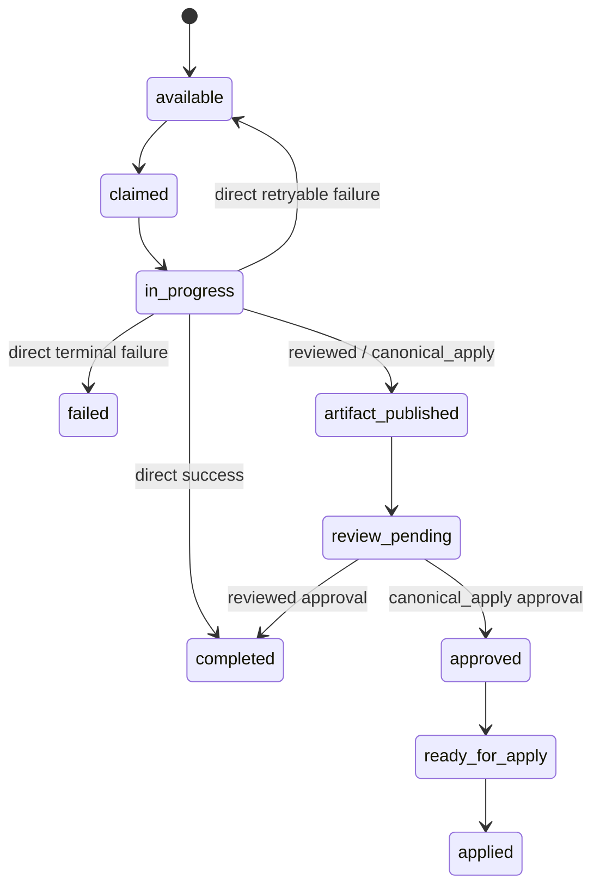

# Covey

Covey is a small, correctness-critical coordination substrate for agent cohorts. It stores the shared state for a decomposed task and answers four questions:

1. What work exists?
2. Who is doing what right now?
3. What result or artifact did a session produce?
4. What happened, in order?

That is the whole job. Covey stores state, enforces invariants, and exposes
changes. It can serve as a local agent work queue, but it does not plan work,
supervise or spawn agents, apply patches, invoke models, or act as a
general-purpose workflow engine.

Covey is the transactional coordination substrate that higher-level agent-cohort
stacks embed: schedulers, apply gates, and settlement/landing authorities all
talk to Covey for the state that must never be ambiguous. It is intentionally
not an orchestrator — it is the floor underneath one.

Version: `0.1.0`.

## Scope

Covey is intentionally narrow.

- It is not an orchestrator.
- It is not a merge queue.
- It is not a message bus.
- It is not a general application database.
- It is not a distributed system.
- It is not a replacement for git, mutAI, or other higher-level coordination systems.
- It is not an agent supervisor, polling loop, process scheduler, or retry timer.

If a proposed feature does more than store, constrain, and notify, it probably belongs somewhere else.

## Design Principles

- Stability over features. Covey is the floor other components depend on.
- Integrity by construction. Invariants live in database constraints or transaction-scoped checks, not comments.
- Transactional atomicity. Every state change and its event-log append happen in one transaction or not at all.
- State-first design. Relational tables are authoritative; the event log is a consequence of mutations, not the source of truth.
- Loud failure. Invalid operations return typed errors at the API boundary.

## Architecture

The intended v1 shape is a single Rust coordination service over one authoritative transactional store. The first deployment mode is embedded: wrapper processes link the `covey` crate directly and share one Covey state store.

In this repository, the embedded library API is the primary interface. Daemonizing it behind HTTP or gRPC later should be a transport concern, not a data-model change.

Embedded-first keeps early development simple. Moving to a daemon later should be a transport change, not a data-model rewrite.

## Core Model

Covey tracks a fixed set of entities:

- `sessions`: who is connected, what role they have, and when they last heartbeated
- `meta_tasks`: top-level operator work items
- `meta_task_source_links`, `meta_task_supersedes`, `meta_task_dedupe_keys`,
  `meta_task_annotations`: side rows holding a source backlink, supersede
  links, the principal-scoped dedupe keys tasks were filed under, and
  annotations with a closed key set
- `subtasks`: decomposed units of work with immutable completion and evidence
  policies and exact routing keys, including first-class review subtasks
- `claims`: fenced ownership of a subtask with leases
- `subtask_attempt_outcomes`: immutable success, retryable-failure, or
  terminal-failure receipts for direct work attempts
- `artifacts`: immutable outputs identified by digest
- `reviews`: verdicts attached to an exact artifact digest
- `reservations`: advisory path-scope hints for planning
- `ready_queue`: approved artifacts waiting for apply, with leased apply claims
- `event_log`: append-only change feed for subscribers
- `conflicts`: visible unresolved situations needing intervention

Schema changes are forward-only.

## Invariants That Matter

Covey exists to make invalid states hard or impossible.

- At most one active session per `agent_principal_id`
- At most one held claim per subtask
- Fence tokens increase monotonically per subtask claim lifecycle
- Completion policy, evidence policy, and routing key are immutable task facts
- Candidate reads and `claim-next` match one exact routing key; without
  configuration, that route is `default`
- Direct attempt outcomes require the current held claim and exact fence, and
  close that claim in the same transaction
- A held claim stays valid for its owner after its lease lapses. The lease
  decides only when the claim may be taken away: once `maint expire-claims`,
  stale-session reaping, or the next claim on that subtask has expired it, the
  old owner's calls answer `claim_not_held`
- `direct` work cannot publish artifacts, request review, or enter the apply
  queue; `reviewed` work cannot enter the apply queue; only
  `canonical_apply` work can reach `applied`
- Ready-queue apply claims are fenced and leased before apply completion is accepted
- Artifact digests are unique and immutable
- Reviews bind to one exact artifact digest; a new artifact requires a new review
- At most one queued or in-flight ready-queue entry per subtask
- Every successful mutation appends exactly one event-log row
- Failed validations append no event-log row and leave no partial state
- Every meta task carries a unique numeric handle issued by the store and
  numbered by the schema in creation order
- A meta task ends in `completed` or `cancelled` with a typed closure reason:
  `done`, `upstream_closed`, `superseded`, or `dropped`; rows that predate
  migration 038 carry none
- A replaced meta task has at most one replacement
- A submission with a dedupe key resolves to the submitting principal's open
  meta task under that key when one exists; a task that ended keeps its key and
  never matches
- A store opened with `--read-only` refuses every write
- Timestamps written by mutations never run backwards: store time is the wall
  clock ratcheted through the lease clock inside each write transaction

These guarantees are enforced through database constraints plus transactional checks in the Covey API layer.

## Completion Policies

Every work subtask has one immutable completion policy:

- `direct` (default): the executor records a fenced attempt receipt with a
  summary and optional evidence digest. Success ends in `completed`; a retryable
  failure returns the task to `available`; a terminal failure ends in `failed`.
- `reviewed`: the executor publishes a non-applyable immutable artifact and an
  independent reviewer decides the exact digest. Approval ends in `completed`
  without creating an apply-queue item. Generated review subtasks inherit the
  source task's completion policy and routing key.
- `canonical_apply`: the executor publishes an applyable artifact, review
  approval creates the apply-queue item, and authorized landing ends in
  `applied`.

Existing canonical findings and verification artifacts retain the prior
review-to-`applied` compatibility path without an apply-queue item. That path
does not grant direct completion and does not represent Authority settlement.



Canonical-apply approval is a transaction boundary: when a review verdict
approves that policy's current artifact, Covey advances the work to
`ready_for_apply` and creates the queued apply item in the same lifecycle
mutation. The explicit queue enqueue API remains idempotent for callers that
retry after approval, and `queue reconcile-apply` materializes old
approved/ready-for-apply rows that pre-date this invariant. Reviewed approval
instead ends at `completed` without queue state.

Failed review verdicts move the reviewed work subtask to immutable evidence
states: `changes_requested` or `blocked`. Covey creates a new `available` work
subtask linked to the review findings for follow-up execution instead of
reclaiming the failed subtask. Terminal work states include `completed`,
`failed`, `applied`, and `abandoned`; only the state appropriate to the task's
completion policy counts as successful dependency evidence.

Claims are simpler:

`held -> released | expired | revoked`

Reviews are keyed to artifact digests, so stale approvals cannot accidentally bless new outputs.

An attempt receipt is Covey coordination evidence. It proves which live
claim/fence recorded an outcome; it is not Authority evidence, review approval,
repo mutation evidence, or settlement authorization. `completed` therefore
does not mean landed. Canonical repository work remains successful only at
`applied`.

## Workflow Configuration

No configuration is needed for ordinary task execution. The built-in workflow
uses `direct` completion, the `default` routing lane, and optional direct-attempt
evidence. Reviews, artifacts, runtime attestations, and the apply queue remain
available through the governed completion modes; direct work does not need them.

Named profiles compose those existing modes with routing and evidence defaults.
For example, an explicitly supplied `workflows.json` can contain:

```json
{
  "default_profile": "simple",
  "profiles": {
    "simple": {},
    "evidenced": {
      "evidence_policy": "required"
    },
    "reviewed": {
      "completion_policy": "reviewed",
      "routing_key": "review"
    },
    "canonical": {
      "completion_policy": "canonical_apply",
      "routing_key": "mutai"
    }
  }
}
```

Use `covey --config ./workflows.json --profile reviewed ...` to select a profile.
If `--profile` is omitted, the file must provide `default_profile`. No file is
discovered implicitly, and `--profile` alone is an error. This format is separate
from any consumer-owned backlog `covey.json` dispatch policy.

Omitted profile fields mean `direct`, `default`, and `optional`, respectively.
The `evidence_policy` setting controls only direct finish/retry/fail receipts;
it never disables the artifact, independent-review, or apply-gate requirements
of a governed mode. A supplied digest must always be valid, even when optional.

Profiles are defaults, not an authorization boundary. Creation flags
`--completion-policy`, `--routing-key`, and `--evidence-policy` override them
for new tasks. The resolved values are stored immutably on each task.
Reopening without the config cannot weaken an existing task, and reusing a
creation idempotency key with different resolved values is a conflict.
Default claim-next, candidate, and availability operations use the profile's
route; explicit routing flags select another exact lane.

Invalid JSON, unknown or duplicate fields/profile names, invalid routes, and
undefined profile selections fail before the CLI opens the database.
Library callers use `Covey::open_with_workflow` and `WorkflowProfile`;
`Covey::open` keeps the simple default. `create_subtask` uses the opened profile,
while `create_work_subtask` takes explicit policies and routing.

Migration 036 preserves existing tasks with required evidence and keeps their
outcome history. Only newly created ordinary tasks get the optional default.
For library consumers, direct outcome request constructors now accept
`Option<String>` evidence, and result records expose an optional digest
(`null` in JSON when absent). Historical evidence-bearing outcomes remain readable.

Migration 038 adds the typed meta-task columns and three side tables, numbers
existing meta tasks in creation order, leaves every other new column NULL, and
parses nothing out of `prompt_text`.

## API Shape

The crate exposes a narrow `Covey` API grouped around:

- session lifecycle: register, ensure, heartbeat, exit
- meta-task lifecycle: submit, complete, annotate, and cancel, plus filtered
  listing and handle lookup
- subtask lifecycle: create with policy/routing, claim by exact route, start,
  finish, retry, fail, abandon, and release claim
- lease lifecycle: renew claim and reservation leases
- artifact publication
- review request and decision
- ready-queue inspection plus atomic apply-claim operations for the apply gate
- reservation request, release, and overlap lookup
- event fetching
- conflict listing and resolution
- status queries and maintenance operations

All mutating requests carry a `session_token`. Ownership-sensitive operations
also require a fence token. Routing keys partition candidate and claim-next
selection; they are coordination selectors, not credentials or authorization.

Session tokens are coordination handles, not a security boundary in the
single-user local deployment model: anyone who can read the store file can
already change it. `meta list` summaries omit the creator session token.
`events list` and `session active-for-principal` return live session tokens by
design, the second so that a principal's next process can find its own active
session. `--read-only` is the enforced write fence.

## Concurrency And Liveness

Covey relies on single-writer transactional serialization in the local deployment model.

- Mutations execute as one transaction or not at all
- Read paths observe committed state
- A writer waits for the store's write lock for up to three busy timeouts
  (5 s each). A store that stays locked answers `StoreBusy` (CLI code `busy`,
  exit 6) with nothing written, so the same call is safe to retry
- Opening a store that is at this binary's schema version runs no migration
  and takes no lock. Opening an older store migrates it under an exclusive lock
  on the sidecar file `<db path>.migrate.lock`, so concurrent openers migrate
  it once; an opener that waits longer than 15 s answers `StoreBusy`. A
  foreign-key violation found by a migration rolls that migration back
- Sessions heartbeat every 10s
- Sessions older than the stale threshold are marked `stale`
- Reservations and apply claims are rejected on command paths once their
  leases expire. A subtask claim is not: a lapsed lease only makes it
  expirable, and its owner keeps it until maintenance or another claim on the
  subtask expires it. Maintenance cleans persisted rows lazily

This keeps safety in the substrate and policy in the orchestrator. Covey does
not poll a route, launch a process, renew a worker session on its behalf, or
decide when more capacity should exist.

## Guarantees And Non-Goals

Covey guarantees safety, ordering, and transactional integrity inside one authoritative local store. It does not guarantee distributed consistency, recovery from manual storage edits, or anything beyond the durability model of the chosen backing store.

If something needs to plan, supervise, merge, message, or perform timed repair,
that is outside Covey. A consumer such as a future Hermes adapter may use the
typed queue APIs, but no Hermes integration or Hermes-specific lifecycle is
part of Covey.

## Observability

There are three intended observation surfaces:

- `event_log` for subscribers
- point-in-time status queries for sessions, subtasks, and meta-tasks
- structured process logs with operation name, redacted actor, duration, result, and affected object ids

The database is authoritative. Logs are for diagnosis.

The third surface is switched on by `COVEY_LOG`:
`COVEY_LOG=off|error|warn|info|debug|trace` installs a line-per-operation
formatter on stderr, without ANSI colours; unset means no log output. Each line
carries the operation name, the redacted actor, the duration, the result, and
the affected object ids.

`covey events list --typed` decodes each event payload into its typed form and
always answers one object, `{ typed_event_count, decode_error_count, items }`.
Each item is `{ "status": "typed", "event": ... }` or
`{ "status": "decode_error", "event": ..., "error": ... }` with the raw event,
so a store holding an old payload shape lists without failing.

## Repository Shape

This crate should stay centered on the core coordination library. Wrapper-specific processes can embed it or expose it over RPC later, but the schema, invariants, and transactional behavior are the real product.

The current internal module map and dependency boundaries are documented in [`docs/ARCHITECTURE.md`](docs/ARCHITECTURE.md).

## Integration Model

Covey is embedded by consumer repositories. Lifecycle/scheduler adapters live
in the consuming stack, not in this crate. For example, the mutAI deployment
context wraps Codex lifecycle and tool events into existing Covey CLI commands
plus Authority evidence contracts; those hooks live outside this repository.
Covey remains the owner of `claim-next`, queue `claim-next`, claims, leases,
fences, sessions, reservations, artifacts, reviews, review/apply queue state,
events, conflicts, and lifecycle transitions. Adapters may enforce before local
Codex side effects, but they must not become scheduler, settlement, landing, or
repoops authority.

## Surface

Covey's public surface goes beyond base task tracking. All of the following are
part of the shipped crate today (`src/lib.rs` re-exports the types;
`src/ops/mod.rs` is the operation inventory; `docs/ARCHITECTURE.md` has the
module map):

- **Sessions, meta-tasks, subtasks** with typed completion policies and exact
  routing keys: `direct`, `reviewed`, and `canonical_apply` work, each with
  fenced claims, leases, and attempt receipts
- **Artifacts and digest-bound reviews**: immutable outputs, exact-digest
  verdicts, review subtasks, and follow-up repair
- **Apply queue**: ready-queue items, fenced queue claims, apply-worktree
  state, apply-gate blockers, landing receipts and permissive landing
- **Repoops authority snapshots** (`src/ops/repoops.rs`), runtime attestations,
  and settlement reconcile blockers
- **VCS workspace observation and OpenSpec packet stack projections**
  (`src/ops/vcs_workspace.rs`, `src/ops/vcs_projection.rs`)
- **Current-work projections** for OpenSpec changes (`src/ops/current_work.rs`),
  operator blockers, and OpenSpec archive status/cleanup
- **Reservations, conflicts, and an append-only event log**
- **Import surface**: OpenSpec changes and Better Droid compiled mission packets
  (`src/ops/import/`)
- **Prose intake** for lightweight task ingestion (`src/ops/prose_intake.rs`)
- **Apply-proof verification and sealing** (`src/proof_apply.rs`; CLI
  `proof apply verify/verify-batch/print-contract`)

Keep each area to what it does, not every type. This list is representative,
not exhaustive; the authoritative full public surface is the `lib.rs` re-export
list and `docs/ARCHITECTURE.md`. The library API is the primary interface; the
CLI is transport-thin.

## Verification

The minimum verification path is the repo's standing gates, listed under
[Building](#building): `cargo fmt`, clippy with `-D warnings`, and
`cargo test`. The design is only credible if the suite proves the invariants
above: legal and illegal state transitions, uniqueness constraints, fence
checks, reservation overlap behavior, atomicity, and concurrency smoke.

Covey also ships formal-methods artifacts. The `model/` directory contains
Quint specifications that encode the state machine invariants; `tests/`
replays traces generated from those specs (`tests/quint_trace_replay.rs`,
fixtures under `tests/fixtures/quint/`), plus spec integration/property suites
(`tests/spec_integration.rs`, `tests/spec_prop.rs`). `scripts/run_covey_actor_split_proof.py`
exercises an apply proof end-to-end with worker/reviewer/apply/closer in
separate processes. These are specification and model-check replay harnesses,
not a claim that every production path is formally verified.

## Local CLI

Covey now ships a thin local CLI for direct SQLite-backed testing and exploratory work:

```bash
covey --db ./covey.db session register \
  --agent-principal-id agent-a \
  --agent-instance-id run-1 \
  --role executor
```

The CLI is transport-thin by design:

- it maps directly onto the embedded `Covey` API
- it defaults to JSON when stdout is not a TTY
- `--db` falls back to `COVEY_DB_PATH`. With neither, `./covey.db` is used
  only when it already exists
- `--read-only` opens an existing store without creating or migrating it and
  refuses writes with the `store_read_only` code
- a write command creates and migrates a missing store only at a path named
  by `--db` or `COVEY_DB_PATH`. Every other command against a missing store
  answers `store_not_found` and creates nothing: a command that only reads,
  and any command that would fall back to a `./covey.db` that does not exist
- `--version` prints the version, the short commit, and `-dirty` when built
  from a modified tree

Exit codes are stable:

| Outcome | Exit |
|---|---|
| success | 0 |
| `not_found`, `store_not_found` | 1 |
| `invalid_args` | 2 |
| `permission_denied`, `store_read_only` | 3 |
| `conflict`, `source_link_exists`, `store_migration_required` | 4 |
| `internal_error` | 5 |
| `busy` | 6 |

With JSON output (`--json`, or stdout is not a TTY) every command answers one
envelope. Success goes to stdout:

```json
{"ok": true, "data": {"meta_task_id": "..."}}
```

A refusal goes to stderr, with the exit code from the table:

```json
{"ok": false, "code": "conflict", "reason": "claim_not_held",
 "message": "...", "suggestions": ["..."]}
```

- `code` is the coarse class from the table and decides the exit code
- `reason` is the stable snake_case name of the specific refusal, such as
  `claim_not_held`, `stale_fence_token`, or `session_already_active`; a usage
  error raised by the CLI itself has the reason `invalid_args`. Branch on
  `reason`, not on `message`
- `message` is written for people and may change
- `suggestions` is omitted when empty

`busy` means another writer held the store lock for the whole wait; nothing was
written, so retry the same command with the same idempotency key.

Short help:

```bash
covey --help
```

Default workflow (no configuration or governance flags):

```bash
# Register the planner and worker once per run.
covey session register --agent-principal-id orch --agent-instance-id orch-1 --role orchestrator
covey session register --agent-principal-id worker --agent-instance-id worker-1 --role executor

# Create work. kind=work and priority=100 are defaults.
covey meta submit --session-token <orch-session> --prompt-text "ship feature"
covey subtask create --session-token <orch-session> --meta-task-id <meta-task> --title "implement"

# Take and start work. The default claim lease is 30000 ms.
covey subtask claim-next --session-token <worker-session>
covey subtask start --session-token <worker-session> --claim-id <claim> --fence-seq <fence>

# Record the result. Evidence is optional unless the task requires it.
covey subtask finish --session-token <worker-session> --claim-id <claim> \
  --fence-seq <fence> --summary "implementation complete"
```

`subtask retry` and `subtask fail` take the same ownership fields, a summary,
and a `--failure-code`. All three accept `--evidence-digest` when needed.
Workers still renew leases and heartbeat their sessions for long-running work;
the workflow profile does not change ownership, expiry, or dependency rules.

Scheduler read paths are explicit and read-only:

```bash
covey subtask candidates --role executor --limit 50
covey subtask candidates --role executor --routing-key research --limit 50
covey subtask candidates --role reviewer --limit 50
covey queue candidates --limit 50
```

These commands expose exact claimable IDs and ordering facts. Without
`--routing-key` they expose the selected profile's route (`default` when no
config is supplied); an explicit key reads only that exact route. They do not
create claims, advance fences, lease queue items, append events, or perform
lifecycle transitions.

Worklist discovery is also read-only:

```bash
covey meta list --limit 50 --offset 0
```

`meta list` returns a deterministic page of safe meta-task summaries newest
first, ordered by `created_at DESC, meta_task_id DESC`. `--limit` defaults
to 50 and accepts 1–500; `--offset` defaults to 0 and must be non-negative.
Summaries never expose the creator session token, and listing writes no
domain events. Each row also carries the typed tracking fields and side-table
projections described under [Meta-Task Tracking](#meta-task-tracking).

A meta task can carry one typed source backlink: where the intake request
came from, instead of a `Backlink:` line inside `prompt_text`. The link is a
side row (`thread_id`, `received_at`, an absolute `path`, optional `url`,
`origin`, `linked_at`), never a prompt convention.

```bash
# Written with the task at intake: origin=submitted.
covey meta submit --session-token <orch-session> --prompt-text "ship feature" \
  --source-thread-id <thread> --source-received-at <receipt-stamp> \
  --source-path /data/intake/notes.md --source-url https://example.test/thread/7

# Attached later to an existing task: origin=backfilled, method required.
covey meta link-source --session-token <orch-session> --meta-task-id <meta-task> \
  --thread-id <thread> --received-at <receipt-stamp> \
  --path /data/intake/notes.md --method "commander transcribed the message"
```

The three source fields on `meta submit` are all-or-none, and `--source-url`
requires them; a partial set is a usage error. A link is set once: a task that
already has one is refused with the `source_link_exists` error code, and both
writers need the same orchestrator authority as `meta cancel`. `meta status
--json` renders it as `data.meta_task.source_link`, or `null` when the task has
none; the linking session is stored but never rendered. `meta list` renders
the same link as `source_link` on each row.

Apply-queue reconciliation is an explicit write path for operator and scheduler
bootstrap:

```bash
covey queue reconcile-apply --session-token <orch-or-apply-gate-session>
```

It advances approved artifacts to `ready_for_apply` and enqueues missing
ready-for-apply items exactly once.

### Meta-Task Tracking

A meta task carries typed fields, so callers stop encoding them as lines inside
`prompt_text`:

```bash
covey meta submit --session-token <orch-session> --prompt-file notes/task.md \
  --title "ship feature" --urgency high --due 2027-01-31
```

`--title`, `--urgency low|medium|high`, and `--due YYYY-MM-DD` are optional and
stored on the row. `--prompt-text` and `--prompt-file PATH` are the two ways to
supply the prompt; `-` reads it from standard input, one trailing newline is
stripped, and exactly one of the two flags is required.

The store numbers every meta task in creation order and gives it a positive
numeric handle. `#N` names that task: `meta status`, `meta cancel`,
`meta complete`, `meta annotate`, and `meta update` accept `--handle N` (or
`#N`) in place of `--meta-task-id`, and every meta-task row carries `handle`.

```bash
covey meta status --handle 12
covey meta complete --session-token <orch-session> --handle '#12'
covey meta cancel --session-token <orch-session> --handle 12 --closure dropped
```

`meta complete` closes a task and appends one event. It stores closure `done` by
default and refuses a task with open subtasks with the `conflict` code.
`--closure` on `meta cancel` defaults to `dropped`.

`meta update` sets or clears the typed fields of an existing task, whatever
state it is in:

```bash
covey meta update --session-token <orch-session> --handle 12 --urgency high --due 2027-02-15
covey meta update --session-token <orch-session> --handle 12 --clear-due
```

`--title`, `--urgency`, and `--due` each have a `--clear-<field>` twin
(`--clear-title`, `--clear-urgency`, `--clear-due`). At least one change is
required, and one call cannot both set and clear a field. The update needs an
orchestrator session, appends one `meta_task_updated` event, and answers the
task's row in the shape `meta list` returns.

`--supersedes ID` is repeatable. Each replaced task is retired in the same
transaction with closure `superseded` unless it already ended, and a task can be
replaced once. An unknown id refuses the whole submit and writes nothing.

```bash
covey meta submit --session-token <orch-session> --prompt-text "ship feature again" \
  --supersedes <meta-task-a> --supersedes <meta-task-b>
```

`--dedupe-key` allows at most one open meta task per key per agent principal:

```bash
covey meta submit --session-token <orch-session> --prompt-text "ship feature" \
  --dedupe-key intake-77
```

While the principal has an open task (`planning` or `active`) under the key, a
repeated key returns that task and writes nothing; the JSON ack then carries
`deduplicated: true`. A task that ended keeps its key for audit and no longer
matches, so the next submission under the key files a new task. Every submit
ack carries `state`, the state of the task it returns.

`meta annotate` writes one annotation from the closed key set `verdict`,
`acked`, `tier`, and `entity`:

```bash
covey meta annotate --session-token <orch-session> --handle 12 --verdict pass
covey meta annotate --session-token <orch-session> --handle 12 --acked true
covey meta annotate --session-token <orch-session> --handle 12 --clear verdict
```

Supply exactly one of `--verdict`, `--acked true|false`, `--tier`, `--entity`, or
`--clear KEY`. An annotation needs an orchestrator session, and `meta status`
shows the current values under `annotations`.

`meta list` pages, filters, and sorts:

```bash
covey meta list --state open --due-before 2027-02-01 --sort due --limit 20
covey meta list --source-thread-id <thread> --dedupe-key intake-77
```

`--state` accepts `open`, `planning`, `active`, `completed`, and `cancelled`;
`open` means a task that is `planning` or `active`. `--due-before`,
`--source-thread-id`, and `--dedupe-key` filter, and `--sort` accepts
`created_at`, `due`, or `urgency`. `--dedupe-key` lists every task filed under
the key, open or ended. Each row carries `meta_task_id`, `prompt_text`,
`state`, `created_at`, `updated_at`, `title`, `urgency`, `due_on`, `closure`,
`handle`, `dedupe_key`, `source_link`, `annotations`, `subtask_total`, and
`subtask_open`. `--compact` omits `prompt_text` from every row and changes
nothing else, for callers that scan many tasks before reading one.

### Session Ensure

`session ensure` takes the `session register` flags and returns the principal's
active session when it already has the requested role, registering one otherwise:

```bash
covey session ensure --agent-principal-id worker --agent-instance-id worker-2 --role executor
```

An active session with another role is refused with `permission_denied`. The JSON
ack carries the session handle and `registered`.

### Subtask Dependencies

`subtask create --depends-on` declares prerequisite subtasks. Repeat the flag
for more than one; a dependency may live in any meta-task and be in any state.

```bash
covey subtask create --session-token <orch-session> --meta-task-id <meta-task> --title "integrate"
covey subtask create --session-token <orch-session> --meta-task-id <meta-task> \
  --title "integrate" --depends-on <subtask-a> --depends-on <subtask-b>
```

Dependencies gate CLAIMING only: they delay when a subtask becomes claimable and
add no review, evidence, or other requirement. Unknown or self-referential
dependencies are rejected and nothing is created. `subtask status` reports the
declared edges under `dependencies`, each with the dependency's state and
whether it currently satisfies the claim gate.

### OpenSpec Import

`covey import openspec` maps one OpenSpec change into deterministic Covey task state. For
Better Droid changes, run `better-droid compile <change-id>` first so the change contains the
compiled mission packet set under `.codex/state/better-droid/<change-id>/mission/`.

```bash
covey import openspec --change openspec-covey-importer \
  --project-root /path/to/project --dry-run
covey import openspec --change openspec-covey-importer \
  --project-root /path/to/project --session-token <orch-session>
```

- `openspec:<change-id>` becomes the meta task ID.
- `openspec:<change-id>:<task-id>` becomes each work subtask ID.
- `--dry-run` validates compiled mission artifacts, diffs, and emits the JSON summary without writing records or appending events.
- Write mode requires an active orchestrator `--session-token`.
- Imported subtasks remain `available`; the importer does not claim work, schedule workers, enqueue apply work, mutate OpenSpec files, or touch mutAI runtime state.
- Active claimed subtasks conflict instead of being silently rewritten when their compiled task digest changes.

The importer reads `proposal.md`, `design.md`, `tasks.md`, `specs/*/spec.md`, and the Better
Droid mission artifacts: `mission.json`, `traceability.json`, `validation.json`,
`path-policy.json`, `review-rubric.json`, `assumptions.json`, and `compile-report.json`.
`compile-report.json` must be `status: covey_import_ready`, `import_ready: true`, and
`readiness.covey_import_ready: true`, and it must bind source, artifact, and compiled task
digests. Planning-only packets with `status: planning_ready` are valid planning input but are
not importable live Covey work.

## Project Standard

Covey should stay boring. If it becomes interesting, it is probably taking on responsibilities that belong in the orchestrator, the apply gate, or the execution wrapper.


## Building

This repository builds and tests standalone; there are no workspace or
git-dependency links to other repositories.

```bash
cargo build --workspace --all-targets
cargo test --workspace --all-targets
cargo clippy --workspace --all-targets -- -D warnings
cargo fmt --all --check
```

The single binary is `covey` (`cargo run --bin covey -- --help`).

### Vendored dependency: `vendor/better-droid`

`vendor/better-droid` is a snapshot of the Better Droid compiler crate that
produces the compiled mission packets `covey import openspec` consumes. It is
vendored so this repository has no external path or git dependencies. See
`vendor/better-droid/README.md` for the source commit and refresh procedure.

## License

AGPL-3.0-or-later. See [LICENSE](LICENSE).

The vendored `vendor/better-droid` snapshot is distributed under the same
license terms as the rest of this repository.