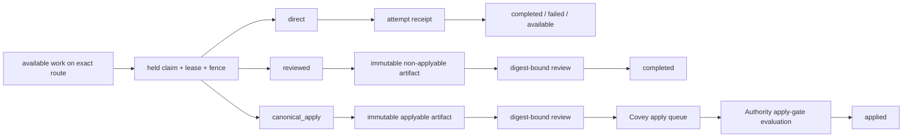

# Covey Architecture

Covey is a small, correctness-critical coordination substrate. The architecture is intentionally boring: one authoritative transactional store, one typed library API, and a thin CLI boundary for local operation.

## Design Rules

- The SQLite schema and transaction checks are the source of truth.
- Domain invariants must be encoded in schema constraints, typed request/response models, or validator functions.
- JSON is a transport format at the boundary, not the internal data model.
- The CLI must stay transport-thin and map directly onto the library API.
- Completion policy, evidence policy, and routing are immutable task facts,
  not runtime supervision or authority grants.

## Module Map

### Core library

- `src/lib.rs`
  Re-export surface for the crate. This is the public API entrypoint.
- `src/config.rs`
  Strict named workflow profiles composing completion mode, routing, and direct
  evidence requirements. No implicit file discovery; the library default is
  direct completion on `default` with optional evidence.
- `src/clock.rs`
  The injectable wall clock: a production clock and a manually advanced one for
  tests. Store time does not follow it backwards: every write transaction
  ratchets the wall clock through a monotonic logical clock inside SQLite and
  uses the result for lease ordering and for the timestamps it writes, so
  wall-clock skew cannot resurrect an expired lease or put `updated_at` before
  `created_at`. Read paths use the wall clock for ages.
- `src/model/`
  Typed domain records, request DTOs, status payloads, event payloads, and
  persisted-state enums, split by concern behind the re-export root
  `src/model.rs`: `records.rs`, `requests.rs`, `views.rs`, `state.rs`,
  `types.rs`, `events.rs`, `imports.rs`, and `helpers.rs`.
  A type with invariants is decoded through an unvalidated intermediate and a
  checked `TryFrom`: a primitive for newtypes, a private `Raw*` mirror struct
  for records. Where that conversion is the whole decode, the type derives
  `Deserialize` with `#[serde(try_from = "...")]`; a type whose decode needs
  more keeps a hand-written impl. Records serialize by projecting onto the
  mirror by reference, because serde's `into` would clone the record on every
  write.
- `src/error.rs`
  Typed domain errors for invalid transitions, ownership violations, lease
  failures, and storage issues. SQLite lock contention surfaces as the
  retryable `StoreBusy`; each variant's snake_case name is the stable refusal
  reason the CLI reports.
  `CoveyError` has no equality: callers and tests match on the variant.
- `src/schema.rs`
  Forward-only migrations, SQLite pragmas, and event-log append helpers. A
  store already at the expected version opens without running the migration
  runner. Otherwise the runner works under an exclusive lock on
  `<db path>.migrate.lock`, and the final migration checks foreign keys inside
  the migration transaction.
- `src/queries.rs`
  Read-side row loading and deserialization helpers.
- `src/validators.rs`
  Transaction-scoped invariant checks and transition guards.
- `src/overlap.rs`
  Reservation overlap normalization, lookup, and conflict recording logic.
- `src/proof_apply.rs`
  Apply-proof verification: the request contract, single and batch verification
  against the queue, review, and artifact rows plus the recorded evidence, and
  the typed error reported instead of a partial verdict.
- `src/store.rs`
  Connection ownership, transaction helpers, idempotency persistence, and shared
  mutation utilities. The write-transaction helper retries the write lock a
  bounded number of times and hands every mutation the store time described
  under `src/clock.rs`. It also owns the read-only open, which creates nothing,
  migrates nothing, and refuses every write, and the pragmas applied to read
  connections. The idempotent-mutation wrapper is also where liveness is
  recorded: a first, successful run refreshes the acting session's heartbeat
  and extends the leases of the subtask claims that session holds, each by the
  duration stored on the claim, so no operation module does this for itself.
  This file should not grow back into the full API surface.

### Operation modules

All library mutations and read workflows hang off `Covey`, but the implementation is split by domain under `src/ops/`.

- `ops/session.rs`
  Session registration, lookup-or-register, heartbeat, exit, and status logic.
- `ops/meta_task.rs`
  Meta-task submission, completion, cancellation, annotation, tracking-field
  update, meta-task status, the filtered list query, and the typed source
  backlink (`meta_task_source_links`) written at submission or attached later
  as a single backfill.
- `ops/workflow/create.rs`
  Default-profile and explicit-policy work creation. Both persist a resolved
  execution contract and emit the same typed `WorkSubtaskCreated` payload. A
  declared dependency must exist and must still be able to satisfy the claim
  gate: a `failed` or `abandoned` dependency without a review follow-up is
  refused, since the new subtask would wait on it for ever.
- `ops/workflow/lifecycle.rs`
  Exact-route claim selection plus the held-claim, lease, fence, start,
  release, and abandon lifecycle, and the retirement of available work that
  nobody holds. A claim request can ask for the start in the same transaction,
  which appends `subtask_claimed` and then `subtask_started`.
- `ops/workflow/completion.rs`
  Fenced direct-work success, retryable-failure, and terminal-failure receipts.
- `ops/workflow/artifact_review.rs`
  Policy-gated artifact publication and exact-digest review lifecycle.
- `ops/workflow/status.rs`
  Policy/routing-aware status, candidate, availability, stuck-work, and
  expiring-claim projections.
- `ops/queue.rs`
  Ready-queue enqueue, claim, apply, supersede, and metrics logic.
- `ops/reservation.rs`
  Reservation lifecycle, overlap lookup, event listing, and conflict resolution.
- `ops/maintenance.rs`
  Lease-based cleanup and stale-session/claim/reservation maintenance, and the
  age-based prune of idempotency rows and, on request, event-log rows.
- `ops/current_work.rs`
  Current-work projection for one imported change set: its blockers, the held
  claims that have gone stale past an explicit threshold, and the resolution of
  each, all derived from Covey rows rather than from the imported source.
- `ops/import/`
  The two governed import adapters. Neither claims work, schedules workers,
  enqueues apply work, mutates the imported source, or becomes a settlement
  authority. The change-set adapter imports Better Droid changes from compiled
  mission JSON artifacts and import-owned provenance only.
- `ops/operator_blocker.rs`
  Operator blockade records, resolution, and lookup, tied to the subtask or
  queue item they block.
- `ops/prose_intake.rs`
  Prose intake: free-text work admitted as canonical-apply tasks with required
  evidence on the configured route, plus its current-work projection and apply
  blockade.
- `ops/repoops.rs`
  Repository-operations authority snapshots over claims, git context, locks,
  policy, and scope facts.
- `ops/vcs_projection.rs`
  VCS pull-request publication and packet-stack projections recorded against
  reviewed work.
- `ops/vcs_workspace.rs`
  VCS workspace registration and observation records.

### CLI boundary

- `src/bin/covey.rs`
  Process startup, help and example text, and the top-level dispatch. Argument
  definitions live under `src/bin/cli/`.
- `src/bin/cli/`
  Clap command and argument definitions: `mod.rs` holds the parser, the global
  flags, and the top-level command enum, and one file per related group holds that
  group's arguments.
- `src/bin/dispatch_support.rs`
  The dispatch router: one arm per parsed command group, each handing off to the
  group's own module. It also resolves the session a command acts as: the token
  the command names, or, for the global `--as` principal, that principal's
  active session in the role the command needs. Commands that start work ensure
  the session; commands that continue held work, the `session` commands, and
  every command against a read-only store only look it up.
- `src/bin/dispatch_support/`
  Per-group translation of parsed arguments into typed `Covey` requests and typed
  success acks, one file per related command group.
- `src/bin/render_support.rs`
  Output-mode selection, human/json rendering, structured error reporting, and typed CLI envelope payloads.

## Dependency Direction

The intended dependency flow is:

`bin/* -> lib re-exports -> ops/* -> validators/queries/schema/store -> SQLite`

Important constraints:

- `render_support.rs` must not acquire domain logic.
- `dispatch_support.rs` must not manually encode ad hoc JSON payloads for typed operations.
- `ops/*` may share helpers through `store.rs`, but business logic should stay in the domain module that owns it.
- `model.rs` and `error.rs` define the language of the system. Other modules should depend on those types rather than invent parallel wire shapes.

## Execution And Settlement Split

Covey has three task completion policies, but only one enters repository
settlement:



Legacy canonical findings and verification artifacts retain their existing
review-to-`applied` compatibility path without entering the apply queue. This
is an explicit compatibility case, not the `direct` policy and not Authority
settlement evidence.

`subtask_attempt_outcomes` is authoritative only for Covey's direct attempt
history. Its summary and optional evidence digest do not attest that a model
was correct, that a repository changed, or that Authority approved settlement.
The `canonical_apply` branch retains the existing artifact, review, queue,
apply-gate, and Authority trust boundary.

Workflow profiles select the existing completion modes rather than bypassing
their checks. `evidence_policy=required` adds a digest requirement to direct
finish/retry/fail; `optional` permits an absent digest, not an invalid one.
The resolved policy is persisted at creation and enforced from the task row,
not the completing process's current configuration. Migration 036 preserves
existing tasks as required-evidence tasks and retains append-only history,
claim binding, and policy immutability. New ordinary API-created tasks use the
simple default; raw SQL inserts retain the fail-closed `required` default.

The CLI validates explicitly selected JSON configuration before opening the
store. Creation flags may override profile defaults for new tasks; profiles
are not organization-wide authorization policies. Resolved creation requests
are also the idempotency input, so a changed effective contract cannot silently
reuse a prior request key.

`routing_key` is an exact eligibility partition used by candidate,
availability, and claim-next operations. Their default APIs use the opened
profile's route (`default` without configuration); explicit routed APIs remain
exact selectors. Routing does not authenticate workers, supervise agents,
allocate capacity, or grant side-effect permissions. Generated review subtasks
inherit their source's completion policy and route.

Specialized governed imports retain their explicit completion requirements.
Lightweight prose intake keeps canonical apply with required evidence while
using the configured route. Consumer-specific change-set settlement paths retain
their explicit routing and apply contracts.

Covey contains no Hermes adapter. A later adapter may register its own sessions
and use an explicit route, but it must own polling, process supervision,
heartbeats, and transport outside this crate. It must not duplicate Covey task,
claim, lease, fence, or attempt-outcome state.

## Meta-Task Source Backlinks

A meta task may carry one intake source backlink: the originating thread, its
receipt stamp, an absolute path, and an optional URL. It is a typed side row
(`meta_task_source_links`, migration 037, one row per meta task), not a
convention inside `prompt_text`, and it is independent of import provenance.

- `meta submit` with `--source-*` writes the row in the same transaction as the
  meta task, with `origin=submitted` and no method. The link is part of the
  submission request, so it participates in the idempotency fingerprint.
- `meta link-source` attaches `origin=backfilled` with a required `method` to an
  existing task that has no link. Set-once: an already-linked task is refused
  with the typed `source_link_exists` error, and the authority rule is exactly
  the one `meta cancel` applies.
- The illegal origin/method pairings are unconstructible in the model, restated
  by table CHECK constraints, and refused again when a row is read back.
- `meta status --json` renders `data.meta_task.source_link` or `null`; the
  linking session is stored and never rendered, and rows predating migration 037
  simply have no link.

## Meta-Task Tracking

A meta task carries typed tracking facts beside its prompt: a one-line title, an
urgency, a calendar due date, and the typed reason a finished task closed. They are
columns on `meta_tasks` (migration 038), not conventions inside `prompt_text`:
nothing parses or rewrites that column, and rows that predate the migration keep
NULL in every new column.

- `title`, `urgency` (`low`, `medium`, `high`), `due_on` (`YYYY-MM-DD`, the day
  checked against the Gregorian leap rule), and `closure` (`done`,
  `upstream_closed`, `superseded`, `dropped`) are optional typed values, each
  restated by a table CHECK constraint.
- `handle` is a store-issued positive number, unique per store. The migration
  backfills existing rows in creation order (`created_at`, then `meta_task_id`),
  and an `AFTER INSERT` trigger numbers every later row the same way, so a raw SQL
  insert, an import, and an API write are numbered alike. Every meta-task verb
  accepts either an id or a handle.
- `meta complete` refuses a task that still has open subtasks and a task that is
  already cancelled; `--closure` is accepted on both terminal verbs, and an
  unspecified closure means `done` for complete and `dropped` for cancel. The
  stored closure is the value the event payload carries.
- A refresh never reopens a completed task that has no subtasks, and whenever a
  refresh moves a task out of a terminal state it clears the closure. When the
  last open subtask of a task settles, the refresh completes the task in the
  same transaction, stores closure `done` if any of its work subtasks is
  `completed` or `applied` and `dropped` otherwise, and appends one system
  event `meta_task_auto_completed` carrying `{ meta_task_id, closure }`.
- Supersede links (`meta_task_supersedes`) give a replaced task at most one
  replacement and are written in the same transaction that retires it: a task still
  `planning` or `active` is retired exactly as `meta cancel` retires it, with closure
  `superseded`, while a replaced task that already ended keeps its state and gains
  the link. An unknown id, or one already listed as replaced, refuses the whole
  submission with nothing written.
- Dedupe keys are principal-scoped (`meta_task_dedupe_keys`, one row per key
  per agent principal per task; migration 039). A submission under a key
  resolves to the principal's open task under it, the newest when several are
  open, and then writes nothing: no task, no event, no idempotency row. A task
  that ended keeps its row for audit and never matches, so the key can file a
  new task.
- `meta update` sets or clears `title`, `urgency`, and `due_on` in any task
  state. Each field change is a typed set-or-clear value, the whole request is
  the payload of one `meta_task_updated` event, and `updated_at` moves.
- Annotations (`meta_task_annotations`) are a closed key set — `verdict`, `acked`,
  `tier`, `entity` — with one value per key per task; `acked` holds `true` or
  `false`, the other keys hold trimmed text. Set and clear each append one
  `meta_task_annotated` event, and clearing a key that is not set succeeds.
  `meta status` renders them beside the supersedes and superseded-by projections.
- `meta list` is one filtered page over `meta_tasks` joined to its source link and
  subtasks: state (`open` means `planning` or `active`), `--due-before` (rows
  without a due date excluded), source thread, dedupe key (every task filed
  under it, in any state), and a sort by creation order, due date (undated rows
  last), or urgency (`high` first, unset last). A compact page does not read
  `prompt_text` and omits it from every row.
- `meta submit` can file work subtasks with the task (`--subtask-title`, one
  per title, in order). They are created inside the submission's transaction
  and under its one idempotency row, each resolved through the opened workflow
  profile as a profile-relative create is. The stored replay record is the
  bare meta-task id for a submission without subtasks and the id plus the
  subtask list otherwise.
- `session ensure` looks up or registers in one transaction: the active session
  the principal holds in the requested role is returned unchanged, and an absent
  one is registered. Active sessions are unique per principal and role, so the
  principal's sessions in other roles are left alone.

## Tracker Core And Settlement Half

The crate ships one library with two halves, and both ship together.

- The tracker core: sessions, meta tasks and their side tables, subtasks, claims,
  attempt outcomes, events, and conflicts.
- The settlement half: the ready queue and its apply claims, apply worktrees,
  apply-gate and settlement blockers, landing receipts, repository-operations
  snapshots and reservations, VCS workspace and packet-stack projections, and
  apply-proof verification in `src/proof_apply.rs`.

Measured 2026-11-26, before migration 038, the store this CLI serves held rows in 10
of its 36 tables. Every settlement-half table was empty, as were the import and
governance records; the only empty tracker-core tables were `conflicts` and
`subtask_dependencies`.

- The halves are not feature-gated and not split into separate crates. Library
  consumers still pin this crate for the settlement flows, so a gate or a split is
  either breaking or churn for them.
- The boundary is documented instead: a tracker operation does not take a settlement
  decision, and a settlement operation does not restate a tracker invariant.
- Revisit only on a concrete consumer need — a request for a tracker-only build, or a
  measured build-time or binary-size cost dominated by the settlement half. Until one
  exists, the conditional-compilation churn buys nothing.
- What to avoid in the meantime is movement across that boundary: settlement behaviour
  added to the tracker core, or tracker behaviour moved into the settlement half.

## What To Avoid

- Reintroducing a monolithic `store.rs` that mixes connection plumbing with every operation.
- Adding workflow logic directly to the CLI layer.
- Using `serde_json::Value` as a substitute for request/response structs in production paths.
- Hiding state-machine rules in comments instead of validators or type shapes.
- Treating `completed` as reviewed, landed, or settled without the policy-bound
  evidence required for those meanings.
- Adding route-specific background workers, polling loops, agent supervision,
  or a second retry scheduler to Covey.

## Verification Expectations

Architectural changes in Covey should usually prove all of the following before being considered done:

```bash
cargo fmt --check
cargo clippy --all-targets --all-features -- -D warnings
cargo test
```
